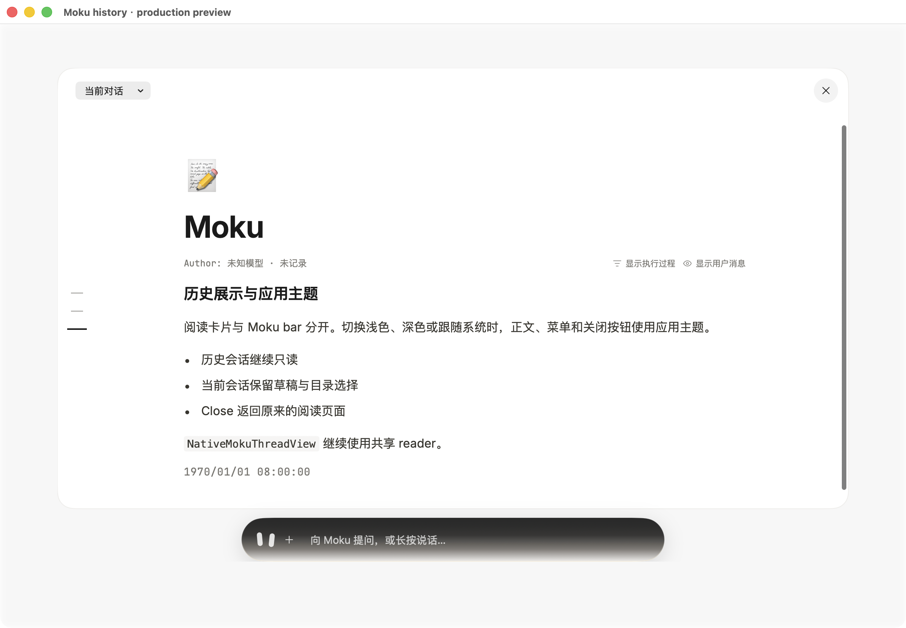

# Mokusei

<p align="center">
  <strong>A native Mac workspace for coordinating AI agents.</strong>
</p>

<p align="center">
  <a href="#get-started">Get started</a> · <a href="docs/README.md">Product guide</a> · <a href="#development">Development</a> · <a href="LICENSE">Apache 2.0</a>
</p>

<p align="center">
  Apple silicon · macOS 26+ · Invited alpha
</p>

---

<p align="center">
  
</p>

<p align="center">
  <sub>Production-component preview with sample content. <a href="demos/moku-history-theme/README.md">About this preview</a></sub>
</p>

Mokusei (木犀) brings Codex, Claude, Pi Agent, and OpenCode into one workspace.
Talk to **Moku**, its coordinating assistant, then open each task's conversation
to follow the work and give it more direction.

- **Ask once, coordinate across agents.** Give Moku a task, attach files, and choose project folders with `@`. Moku can answer directly or assign work to the agents you've enabled. [Working with Moku →](docs/working-with-moku.md)
- **See what needs you.** Overview puts task status, questions, and permission requests on cards. Filter by folder or tag, then open a conversation to step in. [Overview →](docs/overview.md)
- **Read results and keep going.** Read completed replies, revisit earlier runs, send a follow-up, or branch from an earlier run when the agent supports it. [Agent conversations →](docs/task-conversations.md)
- **Connect the work.** Optional Tag Agent groups conversations within each project folder; Super Thread Agent prepares reports with links back to source conversations. Git task cards can show branch and change summaries. [Tags, reports, and file changes →](docs/reports-tags-and-changes.md)
- **Give feedback beside the work.** Open a web page in a sidecard, annotate an element or area, and send the screenshot and comment to the current agent conversation. [Sidecards →](docs/sidecards.md)

The interface uses SwiftUI and AppKit, backed by a Go service. Agents run through
their externally installed tools and retain their own accounts, models, and
credentials.

---

## Get started

Mokusei is available as an **invited alpha** for Macs with Apple silicon and
macOS 26 or later. Get the **Mokusei Alpha** disk image and installation guide
from your inviter.

1. Drag **Mokusei Alpha.app** from the disk image into **Applications**, then open it. The alpha is not notarized; a trusted download may need the per-app **Open Anyway** exception in **System Settings → Privacy & Security**.
2. Install and configure at least one supported agent on your Mac: Codex, Claude, Pi Agent, or OpenCode. Mokusei checks which are ready during setup. Each service determines model access and costs.
3. Choose the agent that will serve as Moku and the agents it can assign work to. Finish the tag and report agent setup, then click **Start using Moku**.
4. Describe your task in **Type a message…**. Type `@` to choose a project folder, send the request, and open the task card when Moku creates one.

No Go, Xcode, or Apple developer membership is needed to use the alpha.
Updates are manual, and alpha app data may be incompatible between versions.
Follow the accompanying installation guide when updating. Fresh installs open
in Simplified Chinese; English is available in Settings.

[Full installation and first-request guide →](docs/getting-started.md)

## Product guide

[Working with Moku](docs/working-with-moku.md) ·
[Overview](docs/overview.md) ·
[Agent conversations](docs/task-conversations.md) ·
[Tags, reports, and file changes](docs/reports-tags-and-changes.md) ·
[Sidecards](docs/sidecards.md) ·
[Settings](docs/settings.md)

## Development

You'll need Apple silicon, macOS 26+, Xcode with the macOS 26 SDK and command-line
tools, and Git. `scripts/go.sh` locates or downloads the pinned Go toolchain and
verifies the official archive checksum. SQLite uses the system C library through
cgo. Mokusei development, builds, and packaging do not require Node; external
agent tools manage their own runtime dependencies.

```sh
git clone https://github.com/hupao-creator/Mokusei.git
cd Mokusei
make build        # build the Go runtime and Swift application
```

`make build` checks compilation without installing an app. To build, sign, and
open the isolated development app:

```sh
make dev
```

Development and production packaging require a valid **Apple Development**
identity with its private key; there is no automatic ad-hoc fallback. The explicit
alpha command needs no Apple account or certificate:

```sh
make alpha ARGS='--build-number 1'
```

This creates a local DMG, installation guide, and checksums under
`app/macos/dist/alpha/`. **Mokusei Alpha.app** uses a separate app identity and data
directory; project folders and external agent sign-ins are shared. The command
does not upload a release. See [native build and packaging](app/macos/build/README.md)
for signing, output paths, and distribution constraints.

<details>
<summary>More build, installation, and runtime commands</summary>

Run these commands individually from the repository root as needed:

```sh
make runtime                     # .build/go/mokusei-runtime
make dev ARGS=--fresh             # rotate development data to <profile>.previous and launch
make check                       # static checks, Go/Swift builds, and routine PBT
make install-hooks               # repository-local pre-commit hook
make pack                        # signed production bundle
make dist                        # signed production bundle and zip
make install                     # build/sign and install to ~/Applications/Mokusei.app
make open                        # open the installed application
make smoke ARGS='--app "/absolute/path/to/Mokusei.app"'
```

`make install` refuses to replace a running installation and requires the signing
identity described above. `smoke` checks packaged metadata, signatures, linkage,
and resources; it does not launch the app or verify interactions.

The service owns its profile independently of the client connection. A
client disconnect does not cancel accepted work; explicitly quitting the native
app requests a coordinated runtime shutdown. After `make runtime`, manage an
isolated profile directly:

```sh
.build/go/mokusei-runtime start --data-dir /absolute/profile
.build/go/mokusei-runtime status --data-dir /absolute/profile
.build/go/mokusei-runtime stop --data-dir /absolute/profile
```

Use `./scripts/go.sh run ./cmd/mokusei-dev --help` for development and installation
options. Native OpenCode allowance-data maintenance lives in `cmd/mokusei-maintain`.

</details>

### Find your way around

| Area | Start here |
| --- | --- |
| Go runtime, services, and plugins | [Module map](internal/README.md), [plugin contracts](internal/core/plugin/README.md) |
| Native application and shared UI | [Native module map](app/macos/README.md), [build and packaging](app/macos/build/README.md) |
| Domain language and state transitions | [Domain terms](CONTEXT.md), [state machine inventory](design/state-machines.md) |
| Interaction previews and visual experiments | [Demo inventory](demos/README.md) |

Before changing code, read [AGENTS.md](AGENTS.md) and the owning module's README.
[Contributor checks](.agents/linting.md) and [CI](scripts/ci/README.md) define
validation commands and their scope. PBT owns runtime invariants, e2e owns
interactions, and benchmarks own user-experience measurements. `make check`
runs static/build checks and routine [PBT](tools/verification/pbt/README.md);
it does not run the separate [product e2e](tools/e2e/README.md) or
[performance measurements](tools/verification/README.md). There are no ordinary
example/table unit-test suites.

The [fact index](tools/verification/facts.md) connects module contracts to their
implementation and verification boundaries; the [coverage map](tools/verification/coverage.md)
records evidence limits. Measurements for another revision do not certify the
current build; before/after comparisons need the named baseline available locally.

## License

Mokusei is licensed under the [Apache License 2.0](LICENSE).
Copyright 2026 hupao-creator.

Third-party materials retain their licenses and attribution notices, including
[agent skills](.agents/skills/LICENSE),
[fonts and icons](app/macos/Sources/Shared/PluginUI/Resources/), and
[Unicode data](internal/services/taglabel/UNICODE-LICENSE.txt).
