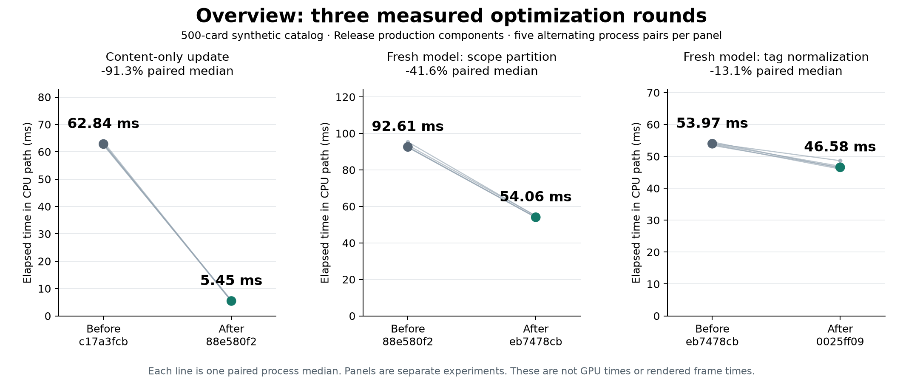

# Overview 多轮性能记录

正式生产基线为 `c17a3fcb270b8d862bbd9cc03ae18c45c4c133fd`，包含已审的子标签提速与测试隔离。
`73a9929c` 只做过代码检查及构建，没有将其计时混入比较。
基准入口提交为 `65f8d204f`；各优化轮次保持独立提交。

[可缩放图表](evidence/cpu-rounds.svg)。每个面板对应自己的五组配对，不能把不同批次当成一次连续试验。

## 环境与方法

- 本机 arm64、macOS 26.5.1 (25F80)、Apple Swift 6.3.2、macOS 26.5 SDK。
- Release `-O`，`-enable-testing` 仅暴露内部集成边界；性能 recorder 关闭。
- 固定 0/5/30/100/500 张卡片、至多 10 个目录、每目录至多 5 个标签，含 Unicode 标题／目录。
  使用真实 Codex 投影、目录 admission、Overview 模型与布局求解器，不启动 Runtime 或 provider。
  Codex 内容为最小 fixture；状态对照每次改变其中一张卡片，没有模拟长历史解析或所有卡片同时流式更新。
- 每条件 3 次预热，随后 20 或 50 次操作；首次模型加载为 5 个独立新模型。
  每轮 5 组独立进程，基线与候选按 AB/BA 交替。同组构建全部结束后才计时。
- 表中为各进程样本中位数的中位数，范围和每组百分比见原始摘要。
  原始 JSON 值在 fixture 外预先生成并重复使用；不含网络传输／JSON 解码、磁盘冷缓存、进程启动或首帧。
- 单次操作为单调时钟经过时间；另存本进程 user + system CPU 时间。
  这些指标均不是应用渲染 FPS、显示刷新率、GPU 时间或光学停帧。
- 每秒采样进程名称和 CPU 占用，检查编译器／其他测试干扰与起止热状态。
  不停止用户应用。采样可能漏掉短干扰，未锁 CPU 频率；前三轮 CPU 对照未记录每轮电源状态，
  后台系统负载和电源／频率变化仍是局限。后续对照会在每进程前后保留 `pmset -g batt`。

原始归档使用 `gzip -dc raw.json.gz` 读取，包含原始条件样本与进程观察。
最初单版本重复基线 5 次中有 3 次检测到编译活动，全部保留并排除；该组不用于收益结论。
第一轮交替对照 5 组均通过上述干扰检查。

## 第一轮：让成员缓存与卡片内容各自更新

探索基线中，500 卡片 catalog admission 约 1.1 ms，但完整状态更新／不变投递约 62 ms。
独立带采样运行的调用栈集中在 `NativeOverviewSelection.select` 的重复筛选、字符串转换与规范化。
采样运行不计入时延统计。

每次 catalog install 曾经重建所有目录／标签成员。现在用完整的成员相关事实判定失效，
缓存当前 catalog 中的身份列表；每次显示与搜索从最新已接收记录解析内容。
签名覆盖可见性、归档、目录身份及标签、语义标签与 emoji、创建时间及顺序、Report 覆盖执行和 locale。
新 authority、显式 refresh 也失效。缓存由主 actor 的 workspace 独占，不共享跨会话数据；
保留的成员与事实受当前目录和暴露筛选范围约束，stop 释放新增缓存。
原始计数也支持该原因：同一工作负载的 500 卡片成员重建从 47 次变为 1 次，30 卡片从 107 次变为 1 次。

| CPU 路径 | 卡片数 | 基线 ms | 第一轮 ms | 配对变化中位数 |
| --- | ---: | ---: | ---: | ---: |
| 状态更新 | 100 | 12.937 | 1.090 | -91.6% |
| 重复投递 | 100 | 12.671 | 0.902 | -92.9% |
| 状态更新 | 500 | 62.843 | 5.453 | -91.3% |
| 重复投递 | 500 | 62.268 | 5.018 | -91.9% |
| 首次模型加载 | 500 | 92.416 | 92.084 | -0.9% |
| 筛选切换 | 500 | 2.200 | 2.209 | +0.9% |

首次加载和筛选切换没有可信收益；搜索／进入返回的小幅波动也不作收益宣称。
这一轮消除的是重复成员构建，后续仍需处理首次构建和真实成员变化。

证据：[完整统计](evidence/round1/summary.md)、[原始数据](evidence/round1/raw.json.gz)、
[构建信息及新增源文件](evidence/round1/build.json)、
[探索调用栈](evidence/baseline/profile.sample.txt.gz)、[被排除的早期基线](evidence/baseline/summary.md)。

回归：新增用例走真实 Overview 模型与 Codex/Report 投影，覆盖最新标题／状态和搜索、
归档／隐藏、scope／标签／emoji、相同创建时间的顺序、authority 切换、清空、
Report 内容刷新、覆盖执行变更、仅目录可见与隐藏／归档。
本轮 Release 筛选运行 `NativeOverviewMembershipTests|NativeOverviewSearchTests|NativeOverviewScopeFilterTests|NativeOverviewTagEmojiTests|GitThreadExtensionTests`：34 个用例的运行摘要通过，其中 4 个环境门控用例跳过，新增 3 个成员回归均执行通过。首次新增 Report fixture 缺少 Runtime 必填 `id`，修正后重新运行完整筛选集合通过。
完整 `make check` 及 GUI 场景结果在任务结束时补充。

## 第二轮：只扫描当前目录的候选成员

本轮基线是第一轮 `88e580f2d` 的生产代码，使用第一轮已保留的 Release 二进制。
首次加载仍需构建全部筛选。原路径为每个目录及其子标签重复遍历整个目录，
对其他 scope 的记录也反复转换和比较身份字符串。现在只在本次重建中按 canonical scope 分组，
每个筛选只扫描自己目录的 Agent Threads；Application 仍走完整候选集，保留未指定 scope 的文档与执行覆盖语义。
这张临时分组表在重建结束后释放，没有新增长期缓存。

13:07–13:08 运行 5 组 AB/BA 对照，全部通过干扰检查。

| 首次模型加载 | 第一轮 ms | 第二轮 ms | 配对变化中位数 |
| --- | ---: | ---: | ---: |
| 5 张卡片 | 0.767 | 0.731 | -4.7% |
| 30 张卡片 | 4.859 | 3.327 | -31.1% |
| 100 张卡片 | 19.033 | 11.002 | -41.1% |
| 500 张卡片 | 92.607 | 54.063 | -41.6% |

500 张卡片热更新为 5.614 → 5.709 ms，配对中位变化 +2.2%，没有声称继续加速。
小规模和未改动布局路径的微小波动不作优化结论。首次加载数字仍仅指新建模型的 admission／projection，
不是应用冷启动或可见首帧。

证据：[完整统计](evidence/round2/summary.md)、[原始数据](evidence/round2/raw.json.gz)、
[构建来源与源码指纹](evidence/round2/build.json)。

本轮 `make check ARGS=` 全部通过；首次不带显式 `ARGS=` 的运行因环境继承 `--fresh` 而被 Go 测试参数解析拒绝，随后已完整重跑。
Debug 的成员／搜索／scope／目录／emoji 集成集合运行摘要为 41 个用例通过（环境门控用例仍跳过）。

## 第三轮：同一次重建只规范化一次重复标签

本轮基线是第二轮 `eb7478cb8` 的生产代码。第二轮独立调用栈仍能看到成员构建中的标签规范化；
相同的少量目录／标签在多张卡片和多个子筛选间重复出现。
现有选择函数接收本次重建拥有的规范化函数，以一个临时字典复用完全相同的规范化结果。
字典只保存本次出现的不同标签，调用结束即释放，不共享线程、不跨 locale／catalog／authority。
普通独立选择入口继续使用原有规范化规则。

13:16–13:17 的 5 组 AB/BA 对照全部通过干扰检查。

| 首次模型加载 | 第二轮 ms | 第三轮 ms | 配对变化中位数 |
| --- | ---: | ---: | ---: |
| 5 张卡片 | 0.694 | 0.646 | -9.6% |
| 30 张卡片 | 3.331 | 2.871 | -14.5% |
| 100 张卡片 | 10.765 | 9.179 | -14.1% |
| 500 张卡片 | 53.973 | 46.579 | -13.1% |

500 卡片热更新 5.542 → 5.433 ms，不作额外热更新收益宣称。布局求解路径未改变。
新增真实模型回归检查全角／半角标签共享 canonical membership，后续 emoji 和标签更改仍立即生效。

证据：[完整统计](evidence/round3/summary.md)、[原始数据](evidence/round3/raw.json.gz)、
[构建来源与源码指纹](evidence/round3/build.json)、[第二轮之后的诊断调用栈](evidence/round3/preceding.sample.txt.gz)。

本轮 Debug 受影响集成集合运行摘要为 42 个用例通过；新增 Unicode 用例执行通过，4 个既有环境门控用例跳过。

## GUI 验证与测量边界

当前完整检查的生产代码包含三轮优化和已审子标签修复。`8dac39dec` 整合了 `0085581e` 的测量工具；
提取共用 fixture 时保留当前生产 Moku Dock 和完整截图实现，没有恢复旧圆形角色。

| 场景 | 实际证据 | 边界 |
| --- | --- | --- |
| 首次／热加载、空／小／大量目录 | 0/5/30/100/500 模型实测；Entry/Capacity/Mounting 回归 | 未测进程冷启动、磁盘冷缓存或可见首帧 |
| Overview 进入／返回 | 阅读返回 5 项、设置返回 3 项，Entry/AutoReturn 等套件 | 本地生产组件 fixture；不含外部 provider |
| 目录／标签切换、子标签展开收起／反转 | 原生 tag-glass 全部 7 项，包含可见动画／像素裁剪；scope/model 测试 | AX／直接输入回放；没有把离屏 AX 当可见动画证据 |
| 水平滚动 | 生产标签滚动、裁剪和 Canvas 输入回放 | 不代表实体触控板延迟／惯性测量 |
| 卡片增长、状态更新、布局重排／窗口宽高变化 | 123 个 Overview 用例的运行摘要通过，含 Capacity/Packing/Transition/Camera；状态更新 CPU 对照 | 窗口宽高变化代表桌面旋转场景；没有移动设备方向传感器 |
| 明暗与 glass on/off | 四张固定生产截图、独立外壳像素检查、6 项挂载回放；四张图片已目视检查 | 截图不是帧率；大目录 CPU 测试不声称 500 张卡片可在一个可读视口内放下 |
| 搜索／清空／返回 | AppKit 运行器执行全部 14 个搜索用例，3 个先前门控跳过的原生场景均执行通过 | 中文语义响应由 fixture 提供；形变回归放慢动画以检查中间几何，不用于生产动画计时 |

完整 `make check ARGS=` 通过；普通 SwiftPM 的环境门控跳过仍在日志中保留，不能以普通套件的成功替代上面的专用原生回放。
没有更改动画时长、玻璃、控件、可访问性或卡片语义来换取数据收益。剩余渲染／GPU成本需要有效呈现轨迹，
当前代码审查中的潜在复杂布局和观察范围不能代替这类实测证据。

## Glass world 原始对照目标：尚未完成

本线程 run-3 在 `8dac39dec` 干净源码上完成全部 32 个区段，后台采样正常退出，recorder 无丢记录／截断／写错误。
但 26 个区段无效：主要是失去 active/key 状态，部分有指针移动或 host busy >40%。
明色静止、明色运动、暗色静止各只有 1 对有效样本；暗色运动为 0 对。
**不能从这轮判断开／关更快或等效。** 失焦的发起者没有记录，不能事后断言全部来自人工操作。
后续工具补记首次失焦时的前台 bundle/PID，不读取窗口标题、不改变前台／指针和有效性门槛。

本轮机器为 MacBookPro18,3 / M1 Pro / 10 CPU 核 / 16 GiB，1200×760pt、2× backing、名义 120Hz；
该刷新率不是应用 FPS。构建时为电池供电、100% 电量；Reduce Motion / Transparency 均 false。
固定 fixture 冻结 Cloud/Moku 自主动画以隔离外壳材质，平移缩放仍走真实 Canvas；这不代表完整动态应用负载，
也不是通过关闭生产动画实现代码优化。

旧线程基于 `119ac92c` 的 INCOMPLETE 数据未用于本次收益结论。本线程的新失败记录也完整保留：
[有效性状态](evidence/glass-run-3/status.json)、[全部区段与排除原因](evidence/glass-run-3/summary.json)、
[原始采样归档](evidence/glass-run-3/raw.tar.gz)、[构建及实际仪器清单](evidence/glass-run-3/build.json)。

GPU／真实渲染帧／呈现卡顿目前仍未取得可归因的数据。重新核对发现本机列出 Metal System Trace、Animation Hitches、
Core Animation FPS 和 Frame Lifetimes，故“没有模板”不适用于本轮；列出模板也不等于已取得有效 trace。
一次无窗口能力探测能开始 3 秒记录，但收尾超时，留下的 trace 导出报 `Document Missing Template Error`，不能用于性能结论。
本机 Developer mode 为 disabled，未改变系统设置；尚不能将收尾失败确定归因于该状态。
真正的渲染／帧生命周期诊断应使用对应轨迹，Task.sleep 唤醒延迟不能替代它们。
参见 [Apple 的响应性分析说明](https://developer.apple.com/documentation/xcode/improving-app-responsiveness)。

该次交接时未重新启动 GUI。新的失焦归属记录通过 Release 构建，电源记录字段通过一次无 GUI 工具校验；
该校验不是性能对照。报告图表已生成并目视检查，完整 `make check ARGS=` 再次通过。

后续已接续用户授权，切到已集成生产 `e7afacc21`，完成工具隔离修正与 run-4/run-5 验证。
run-5 在没有输入／失焦的情况下于第 6 段遇到主机负载超限，保存数据后停止；完整对照仍未完成。
新的构建、各段有效性、后台依赖和可复核归档见[接续记录](../overview-input/evidence/glass-completion/README.md)，
不与本节旧构建样本混用，也不从局部样本推断材质优劣。
