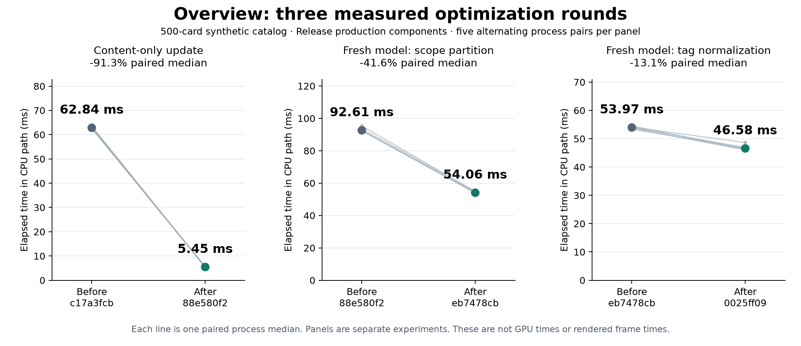

# Overview CPU 路径测量

测量基线：`c17a3fcb270b8d862bbd9cc03ae18c45c4c133fd`；基准入口来源：`65f8d204f`。
每组的 production/binary/probe 身份由对应 build.json 与原始采样确定。
报告不认证当前生产实现，也不把内部状态切换负载当成外部渲染场景。

[可缩放图表](evidence/cpu-rounds.svg)。各面板是各自五组 AB/BA 配对，不能混为连续实验。

## 条件与口径

arm64、macOS 26.5.1 (25F80)、Swift 6.3.2、macOS 26.5 SDK；Release `-O`。
固定 0/5/30/100/500 卡、至多 10 目录和每目录 5 标签，含 Unicode fixture。
生产 Codex 投影、catalog admission、Overview 模型和布局求解器在无 Runtime/provider
的独立进程内执行。每条件 3 次预热后重复 20 或 50 次；首次 admission 用 5 个新模型。
表中是进程样本中位数的中位数；原始范围/逐对变化见各组 summary。

单调 elapsed ms 和进程 user/system CPU 不等于渲染帧时、光学 FPS、GPU 或能源。
重用预先构造的 JSON，不含网络、解码、磁盘冷缓存、进程冷启动或首帧。
每秒进程采样可能漏掉短干扰；没有锁频、每轮电源状态或完全空闲机器保证。
早期单版本五次中三次有编译干扰，均保留排除，不用于收益结论。

## 配对数据

组 1 的 500 卡重复成员构建计数为 47→1；30 卡为 107→1。
这只解释该 fixture 的 CPU 观测，不说明当前 UI 搜索或其他渲染实现。

| CPU 路径 | 卡片数 | 基线 ms | 第一轮 ms | 配对变化中位数 |
| --- | ---: | ---: | ---: | ---: |
| 状态更新 | 100 | 12.937 | 1.090 | -91.6% |
| 重复投递 | 100 | 12.671 | 0.902 | -92.9% |
| 状态更新 | 500 | 62.843 | 5.453 | -91.3% |
| 重复投递 | 500 | 62.268 | 5.018 | -91.9% |
| 首次模型加载 | 500 | 92.416 | 92.084 | -0.9% |
| 筛选切换 | 500 | 2.200 | 2.209 | +0.9% |

证据：[统计](evidence/round1/summary.md)、[raw](evidence/round1/raw.json.gz)、
[build/source](evidence/round1/build.json)、[采样栈](evidence/baseline/profile.sample.txt.gz)、
[排除组](evidence/baseline/summary.md)。

组 2 基线制品来源 `88e580f2d`；五组配对：

| 首次模型加载 | 第一轮 ms | 第二轮 ms | 配对变化中位数 |
| --- | ---: | ---: | ---: |
| 5 张卡片 | 0.767 | 0.731 | -4.7% |
| 30 张卡片 | 4.859 | 3.327 | -31.1% |
| 100 张卡片 | 19.033 | 11.002 | -41.1% |
| 500 张卡片 | 92.607 | 54.063 | -41.6% |

500 卡热更新 5.614→5.709ms（配对中位变化 +2.2%），不构成继续加速结论。
证据：[统计](evidence/round2/summary.md)、[raw](evidence/round2/raw.json.gz)、
[build/source](evidence/round2/build.json)。

组 3 基线制品来源 `eb7478cb8`；五组配对：

| 首次模型加载 | 第二轮 ms | 第三轮 ms | 配对变化中位数 |
| --- | ---: | ---: | ---: |
| 5 张卡片 | 0.694 | 0.646 | -9.6% |
| 30 张卡片 | 3.331 | 2.871 | -14.5% |
| 100 张卡片 | 10.765 | 9.179 | -14.1% |
| 500 张卡片 | 53.973 | 46.579 | -13.1% |

500 卡热更新 5.542→5.433ms，不作额外热更新收益宣称。
证据：[统计](evidence/round3/summary.md)、[raw](evidence/round3/raw.json.gz)、
[build/source](evidence/round3/build.json)、[诊断栈](evidence/round3/preceding.sample.txt.gz)。

## 失败数据与测量限制

玻璃 run-3 的制品来源 `8dac39dec`，共 32 区段，26 段因失焦、指针输入或 host busy
等条件无效。明色静止/运动、暗色静止各仅 1 对；暗色运动 0 对，没有完整比较。
机器 MacBookPro18,3 / M1 Pro / 10 核 / 16GiB，1200×760pt、2×，名义 120Hz；
名义刷新率不是产品 FPS。原始 fixture 冻结自主 cloud/Moku 动画，只隔离外壳条件。
证据：[状态](evidence/glass-run-3/status.json)、[区段](evidence/glass-run-3/summary.json)、
[raw](evidence/glass-run-3/raw.tar.gz)、[build/source](evidence/glass-run-3/build.json)。

没有有效可归因 GPU、真实呈现帧或能耗数据。存在 Instruments 模板或 trace 文件不等于
采集成功；一次无窗口 trace 收尾超时且导出报 `Document Missing Template Error`。
不能以唤醒延迟、内部源码计数或另一版本的测试结果填补这些缺口。
