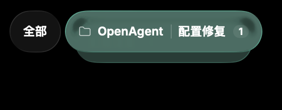
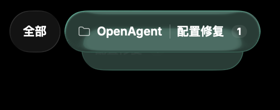
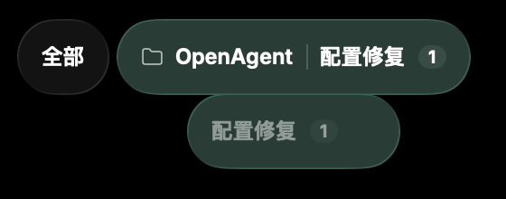
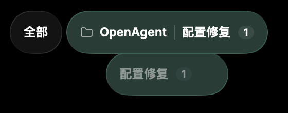
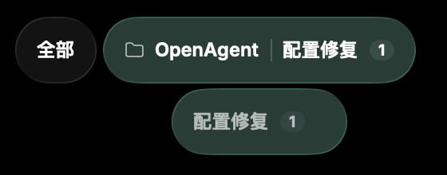
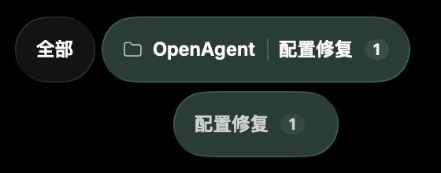
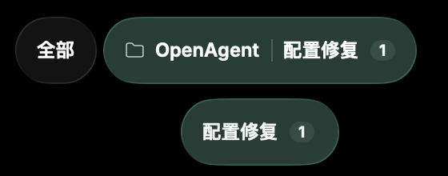
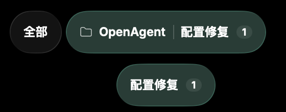

# Faster directory child-tag opening

Follow-up: [native AX failure investigation and verifier correction](subtag-ax-isolation.md).

Capture comparison base: `119ac92c07f5695b78f48e4a17400ac0eddfe9b3` (includes Glass world).
Only `NativeOverviewChrome` submenu opening changes: `.smooth(duration: 0.32,
extraBounce: 0)` → `.smooth(duration: 0.22, extraBounce: 0)` in both the initial
measured reveal and mounted-menu retarget transaction. The configured duration
falls by 100ms (31.25%). This is SwiftUI's spring duration parameter, not a
measured guarantee that the final pixel stops moving at exactly 220ms.

The same geometry transform, label opacity curve, native glass, measurement
gate, identities and Reduce Motion behavior remain. Closing is still 320ms;
hover dismissal still waits 180ms. Top-level tag, title, scroll-width and global
animations are unchanged.

## Native before/after evidence

Both revisions ran all six existing native tag-glass cases successfully. The
optional artifact path extends the existing short-child case, opening through
the real production accessibility action after a complete close. No alternate
UI or animation implementation is used. The screenshot crops below are native
WindowServer pixels, cropped at x=450, y=75, width=560, height=220 from 1440×584
captures. Crop origin is identical across both runs.

| Target offset | Before: 320ms spring | After: 220ms spring |
| --- | --- | --- |
| 50ms |  |  |
| 100ms |  |  |
| 150ms |  |  |
| 220ms |  |  |
| 320ms |  |  |

At 100/150ms the new child is farther from its parent and its text is more
visible. At 220ms it is near the settled presentation; a small spring tail
remains. The sampled sequence preserves continuous capsule shape and separation,
without an observed cut or snap. Screenshots cannot establish optical frame
pacing between samples.

Capture timing starts immediately before the AX action, including mounting and
measurement. WindowServer readback has latency. For example, the 100ms samples
span 101.27–128.44ms before and 101.43–128.79ms after; 150ms spans
151.53–178.48ms before and 151.50–174.58ms after. Full intervals:
[before](subtag-transition-speed/before-times.json),
[after](subtag-transition-speed/after-times.json).

Reproduce (sequentially on each production revision):

```sh
MOKUSEI_TAG_MORPH_ARTIFACTS=/tmp/subtag-evidence python3 tools/verification/reading-presentation/run.py --tag-glass
```

Full 0/50/100/150/220/320/450ms opening frames, closing frames and replay logs
are retained locally in `.build/verification/subtag-transition-speed/`.
The suite covers narrow/zoomed widths, glyph bounds, child selection and title
handoff, close/reopen interruption, child removal, menu hit regions and canvas
scroll ownership. It does not drive physical pointer/trackpad delivery or
measure FPS, and it does not change system accessibility preferences. Reduce
Motion is preserved by code review, not toggled for this run. No runtime,
provider, real model, deployment or push is involved.

## Integration

The final commit is based on `e70ca9877603d978d9910d73a4a1b32a614837dc`,
which includes Glass world and the reviewed directory-capsule clipping fix
(original review commit `519e58402326e429437d8a85887a905f7b942712`). That fix's
animatable leading/trailing overflow shape remains intact. The speed change
has no production-code conflict with it. The final replay selector retains
both the six-case Glass world mounting branch and seven-case tag-glass branch.
The before/after frames above were captured on `119ac92c` plus only the speed
change, before the parent supplied the newer integration base; final combined
validation is recorded below. Neither main nor another worktree was edited.

## Validation results

- Original-base before and after: six native tag-glass cases passed each.
- Original-base `make check ARGS=` passed, including 13 directory-tag cases.
- Integrated `e70ca987` + speed change: all seven tag-glass cases passed on
  rerun using the identical already-built executable (33.063s). The first run
  passed both capsule pixel cases but failed menu input at the final child AX
  lookup before selection: the child was absent. No source change was made
  between that failure and the passing rerun. Its cause is unconfirmed; native
  hover/AX interaction remains a replay limitation. Both logs are retained.
- Final integrated `make check ARGS=` passed: architecture/format, Go vet/build,
  Swift build with tests, concurrency properties, module tests and 13 native
  directory-tag cases. Local diff and evidence-link review passed.
- Integrated capsule captures preserved rounded ends (minimum right inset
  24 pixels in the shrinking sequence), plus both scroll-edge checks.
- Six Glass world mounting cases were reported passed by the parent on
  `e70ca987`; they were not rerun here because this change only touches menu
  opening timing. No unrelated load/performance benchmark was started.

The initial sandboxed baseline build could not invoke SwiftPM's nested sandbox;
rerunning with approved native-build access succeeded. Full checks clear the
inherited unrelated `ARGS=--fresh` via
`env -u MAKEFLAGS -u MAKEOVERRIDES -u MFLAGS make check ARGS=`.
