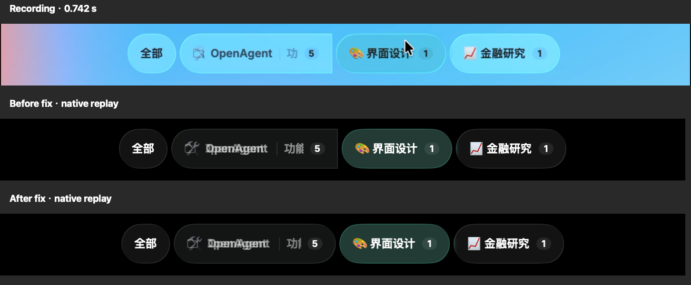

# Directory glass clipping during selection

Source: `录屏2026-10-25 11.51.20.mov`, attachment
`41ecfa92-50bf-4a2a-bc38-9b934122e388`.
SHA-256: `ff45be2861b0b332a0a82de655eb6bc52427721a23512e0f08e35fc545b92b97`.
AVFoundation decoded 1452×246 pixels, 8.095 seconds, variable frame times.



The recording switches from `OpenAgent / 功能改进` to `界面设计`, selects
`功能改进` through the directory menu, then switches to `界面设计` again.
At 0.70–0.80s and 4.45–4.60s, the **directory glass capsule's right end** becomes
rectangular while shrinking; it is round again when settled. This is independent
of the emoji glyph bounds and does not involve Thread glass.

The parent glass previously intersected an absolute measured source capsule
with an animated frame. Those sizes did not interpolate together, so the frame
cut off the source's rounded end. It now builds the capsule from the current
frame and the leading/trailing offscreen overflow. Actual scroll clipping is
preserved without changing label layout, animation timing or glass style.

## Native verification

The regression uses production `NativeOverviewChrome`, real accessibility
selection/menu actions and WindowServer screenshots in an isolated AppKit app.
It failed on `2c2b8b80c70b9f44ad7317d5885b27c30d0e106c`: three shrinking frames
violated the corner check, with right insets of 4, 0 and 0 pixels. With the fix,
all seven tag-glass cases passed. The 12 shrinking samples included intermediate
widths; their minimum right inset was 24 pixels. Both leading and trailing
scroll clipping passed inside/outside-viewport pixel checks.

Reproduce and retain full frames and measurements:

```sh
MOKUSEI_TAG_SWITCH_ARTIFACTS=/tmp/tag-switch-evidence python3 tools/verification/reading-presentation/run.py --tag-glass
```

The comparison above crops the supplied video near 0.75s (actual frame 0.741667s) and the before/after
native `shrinking-2` captures. Full-resolution source frames, metadata, native
PNGs, `pixels.json`, negative-control logs and build logs were retained locally
under `.build/verification/switch-clipping/` in the implementing worktree.

This verifies real native glass rendering and actions, not optical FPS, physical
pointer gestures or the installed production profile. The new pixel case uses
dark appearance; the existing suite also covers compact/light/dark prefixes,
long titles, zoom and menu interruption. No system accessibility preference was
changed. The separate glass-world feature is not a dependency.

Full repository validation passed with
`env -u MAKEFLAGS -u MAKEOVERRIDES -u MFLAGS make check ARGS=`: architecture,
format, vet/build, Swift build, concurrency properties, module tests and 13
native directory-tag cases. The first plain `make check` inherited
`ARGS=--fresh` / `MAKEFLAGS=ARGS=--fresh` from the environment, so Go rejected
`-fresh`; clearing those unrelated arguments resolved the check without code
changes. Local diff and link review also passed.
